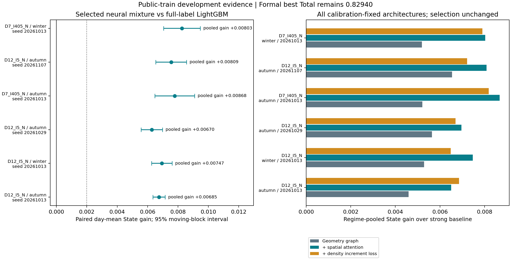
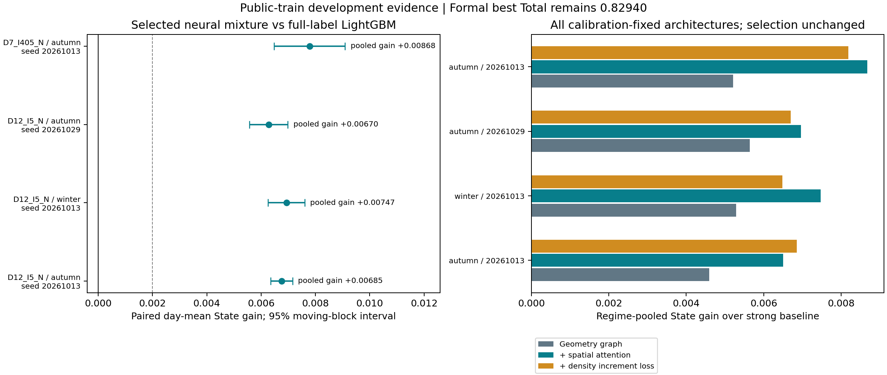
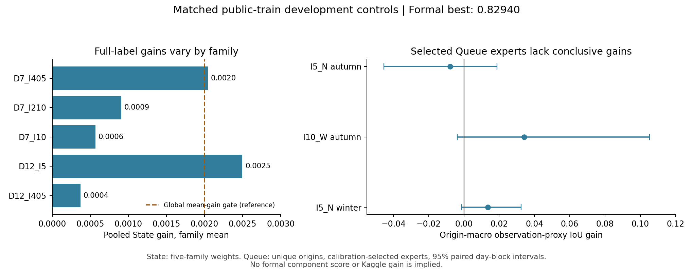
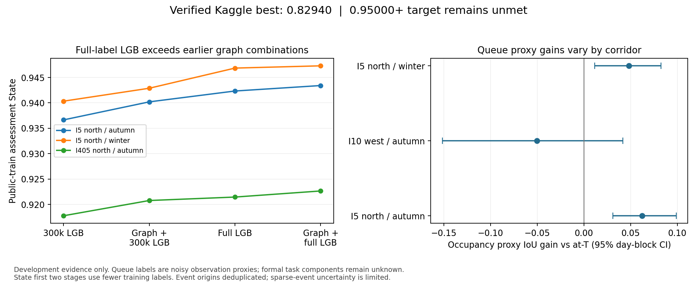
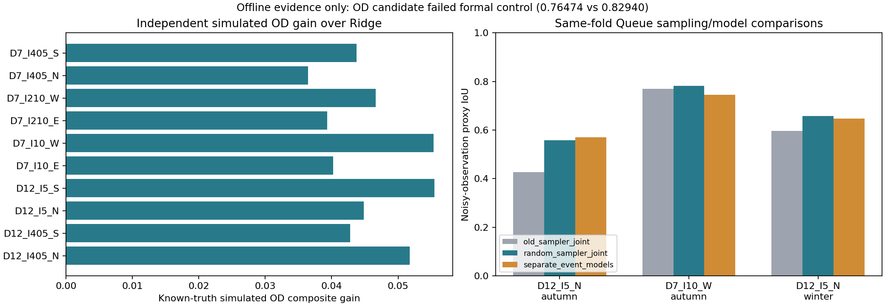

# RESULTS — 0.950+ 高强度研究

**当前已核验的正式 Kaggle Total：0.82940。目标 0.95000+ 尚未达到。**

**A130–A133：相对里程注意力在I210_W取得新增本地State收益。** 只新增两层各一个有符号距离系数（97307→97309参数），初值0、共同权重初始化/普通损失/输入及实际监督曝光均匹配A97。用当前更强的A112通道模型作性能参照，并在cal前固定“新NN速度＋原树流量”组合；cal选中该组合。

| 本地公开TRAIN策略 | 原14日后留 | 预登记2/15–2/28 |
|---|---:|---:|
| A112强参照 | .940049 | .940685 |
| 纯新位置NN均值 | .941372 | .941081 |
| 新速度＋原树流量（cal primary） | **.942187** | **.941826** |
| primary pooled gain vs强参照 | +.002138 | +.001141 |

primary day-mean CI **[.000865,.002862] / [.000743,.001822]**，不是pooled/Kaggle区间；新日期第一seed相对配对NN仅+.000059且CI跨零，第二seed+.002311。旧R3仅1日，新R1/R2/R3为3/5/6日，尚无新方向证据。两新/旧控制均epoch24/alpha.75；不能把组合收益全部算成纯NN改进。

新日期急降速速度RMSE **16.646→18.774** 退步，恢复/60min缺失改善，flow逐格沿用原强参照。旧增量L1旧后留.683813→.678066，新日期.723815→.723928略差；正式Physics未知。训练468.31秒、GPU allocated峰值725.07MiB。A132全距离/初始化/曝光、252次predict与224指标核验通过；A131126次实际predict，A133另18次predict差0、126指标复算。125research/104CPU测试通过，7可选Torch跳过。当前仅新增I210研究模型，无新完整submission或正式测量。详见 [研究记录](docs/RELATIVE_POSITION_STATE_RESEARCH.md)。

**A124–A127：固定.05速度pair目标完成，未晋级。** 两新模型同97307参数/初始化/已有格点曝光，但加入相邻已监督大跳变的差分项；cal gain−.004325，保留冻结NN。全部为公开TRAIN本地State：

| 日期域 | 控制双seed | 新pair-loss双seed | pooled gain | day-mean 95% CI |
|---|---:|---:|---:|---|
| 原14日后留 | .957512 | .952669 | −.004843 | [−.005022,−.003977] |
| 预登记2/15–2/28 | .959782 | .956831 | −.002950 | [−.003752,−.002703] |

两seed相对各自控制的pooled gain两日历均负；新alpha为.75/.5，原控制均.75，不能完全归因单一梯度机制。急降速/恢复速度也退步，新日历15.084/11.531→18.316/14.051。新60min缺失速度1.368→1.327略好，flow27.680→29.540更差；原后留该子集两者都差。旧增量L1两日历.650629→.686754 / .662477→.699876变差，正式Physics未知。新R2只有1日，CI不是pooled或Kaggle区间。

两fit/cal角色517.88/519.50秒、整体1089.42秒、GPU allocated峰值2100.56MiB。A126独立重建两seed cell/pair计数，监督曝光45,754,069/45,844,015次与控制精确一致，pair曝光30,192/30,858次；196次导出predict及168指标核验，最大预测差4.55e−13。A125实际98次predict，A127另14次直接predict差0、98指标复算。原122research/104CPU测试为前阶段记录，此阶段生产src未改，不重复计为新验证。详见 [研究记录](docs/FIT_TRANSITION_AND_JUMP_RESEARCH.md)。没有新完整提交或正式成绩。

**A128/A129：静态测量图覆盖审计完成，没有新增模型增益。** I210_W有53/81孤立测量节点，I5_N为0/258，全部10图经直接CSV ID/union-find独立核验。源码和CPU梯度探针同时证明注意力已全连接；孤立只影响定向消息传递/偏置，不表示不能读取其他节点。里程相邻也不等于真实物理连接。后续可单独验证显式相对距离先验，尚无收益证据。见 [图覆盖与范围](docs/PUBLIC_GRAPH_COVERAGE_RESEARCH.md)。

**A122/A123：公开fit突变审计。** 两方向245日的有效相邻观测中，≥20km/h降速/恢复合计占.2544%/.2100%；在未来两步均有效的子集里，持续变化比例96.76%/98.86%，该子集仅覆盖全部大变化约61%/63%。单步返回比例为1.44%/.58%（另用有效下一步分母）。不能将条件统计当latent噪声或真实拥堵波识别。

这些位置占原mask输入base速度SSE的5.61%/10.57%，不是NN误差或正式State归因。A123独立重建全部245日/3185诊断数组，3430人口及实际曝光记录、SSE汇总通过。四项kernel/手算梯度测试及全套122 research、104 CPU通过，6可选Torch模块跳过。其后固定pair损失的实测负面结果见本文开头；fit误差人口本身不证明新的监督目标有效。

**A116–A121：固定通道规则未能迁移到冬季I5_N，保留原NN。** 从I210_W迁移“NN速度＋point树均值流量”，只重训两个seed的流量树、复用原速度树和NN；没有重搜冬季通道权重。结果全部为公开TRAIN本地State：

| I5_N日期域 | 冻结NN | 固定通道transfer | pooled gain | day-mean 95% CI |
|---|---:|---:|---:|---|
| 原cal（gate用） | .955885 | .955084 | −.000801 | 不作独立证据 |
| 原14日后留 | .957512 | .956624 | −.000888 | [−.000995,−.000777] |
| 预登记2/6–2/19 | .955189 | .954343 | −.000846 | [−.000920,−.000766] |

cal gate按预案拒绝transfer，primary保持NN。两个单seed组合也都更差，未根据后留或forward改选。新日历流量RMSE：急降速123.247→155.013、恢复137.323→157.296、60min缺失32.561→34.039、拥堵46.298→47.238；速度逐格沿用NN。旧增量L1原后留.650629→.672539、新日历.656166→.680281，正式Physics未知。

A121仅用14日cal预测/teacher的误差二次项优化一个有界流量权重，最优.132571、in-sample State gain仅.00001953，未达原.0005门槛，不导出新混合。它在新flow forward打开前完成；源JSON包含已查看的后留摘要，优化器输入只用cal数组，不作盲测或独立收益。

训练表15218248行、765组，磁盘映射文件3.912GiB；准备243.03秒、两次流量拟合290.99/304.11秒、完整A116888.84秒、进程峰值工作集6917.55MiB。完整标签池7294027个不同link/time位置，略多于NN实际采样约700万；不是等标签曝光/优化预算结论。A118独立765组/全部60特征与标量训练数组、8次poison通过，raw流量teacher误差1.19e−7归一化单位、weight差0，344.87秒。A119新14日126指标复算，另18次直接predict最大差4.55e−13，46.37秒。各任务部分并行，不当隔离测速。详见 [冬季迁移研究](docs/WINTER_FLOW_TRANSFER_RESEARCH.md)。原完整提交均冻结，无新正式分数。

A120复用A118已绑定SHA的整表审计，训练文件/源数据重新hash未变，不重复计为765次新重建或8次新poison。对原28日×9导出角色252次predict、238保存指标及cal gate独立重算通过，预测最大差4.55e−13、score差2.22e−16；原速度booster逐字相同、两新流量树各400棵，305.82秒。新生产src未变，原118research/102CPU单元测试记录仅作历史参照。

**A112–A115b：固定分通道集成在I210_W两日期域取得本地State增益。** 根据已查看cal中“树流量好、速度差”的开发证据，固定50组常数权重，仅按cal选择并封存 **GRU速度 + point树双seed流量**。原assessment **.938919→.940049**，pooled gain+.001130；选择前登记的2/6–2/19为 **.940073→.941077**，gain+.001004。两段day-mean CI分别 **[.000879,.001117] / [.000948,.001170]**，不是pooled或Kaggle区间；旧assessment已查看、新日期仍属公开研究域。

没有新增拟合/标签，速度逐格不变，新日历流量在三个regime及急降速/恢复/拥堵子集改善。28个旧日和56个新role/day直接predict与通道公式差0；另行重建28日teacher、112指标和50个cal选择，以及新14日teacher/诊断和56指标。旧增量代理新日历.725316→.717154，但正式Physics未知，不能将分通道模型直接视作联合评分晋级。完整记录见 [通道集成研究](docs/CHANNEL_STATE_RESEARCH.md)。

**A104/A106：冬季重新mask扩展完成，收益较小且未通过稳定性判断。** 校准仍选Queue-shaped双seed均值，四模型alpha均.75。全部为公开TRAIN本地State：

| I5_N固定策略 | 原12/30–1/12后留 | 预登记1/23–2/5 |
|---|---:|---:|
| 原GRU均值 | .956818 | .954500 |
| point重新mask | .957220 | .955275 |
| Queue-shaped重新mask（cal primary） | .957512 | .954872 |
| primary pooled gain | +.000694 | +.000372 |

primary两段day-mean CI **[−.000218,.001466] / [−.000220,.001040]** 均跨零。新日历point更高，但保持已封存Queue-shaped选择；Queue-shaped相对point由旧后留+.000292变成新日历−.000403、名义CI **[−.000524,−.000202]**，不支持把模拟Queue空缺作为统一增益来源。新日历primary拥堵速度RMSE **2.319→2.463**、60min断测速度 **1.860→1.886** 变差，恢复速度 **11.262→9.095**、恢复流量 **124.032→107.164** 改善。旧增量L1两段 **.641245→.650629 / .646055→.659551** 均变差，正式Physics未知。

两方向原后留primary gain简单平均+.002061虽达到原mean门槛，但冬季区间不正；不按均值声称稳定泛化。冬季拟合2154.28秒、GPU allocated峰值2099.12MiB；forward140.97秒。研究测试118通过，CPU102通过/5 Torch skips。没有新全网生产拟合、完整submission替换或正式测量。

A107独立重建4份实际训练标签曝光数组，并重放28日×12角色 **336次predict**，最大差4.55e−13 lane units，277.12秒；没有重训旧控制。A108重建新14日teacher/diagnostics，复算168保存指标最大差2.22e−16，另24次直接predict差0，33.47秒。原完整提交及之前5281项artifact由后继manifest重新核验，所有研究证据另存，不覆盖原清单。

**A102–A111树参照：同视图强LGB提升自身，但未替代A97神经模型。** I210_W原后留的旧树/point新树均值/Queue-shaped新树均值/冻结NN为 **.927102/.931238/.930716/.938919**；预登记1/23–2/5为 **.921600/.924704/.924905/.929704**。两seed、每通道400树/63叶、原profile和60维v2特征，使用相同重新mask标签池，但平方损失/重加权/完整数据遍历与NN不同，不当纯架构或纯数据单因素结论。

Cal在旧树、NN、两新树均值及六种预设混合中仍选NN。新日期.25树混合pooled gain **+.000289/+.000346**，day-mean区间 **[−.000598,.000607] / [−.000513,.000646]**；旧后留还略负，未根据这个次要结果改选。树模型主训练500.86秒CPU；后续含NN的forward32.96秒实际使用GPU，不能当CPU测速。

A110独立重建920个date/view训练表组、teacher/base/row keys/weight，168次纯树角色部署及4次选中策略调用通过，392保存指标复算；A111重建14日teacher/诊断mask并复算210指标，另18次直接predict差0。117 research tests通过；CPU101通过/5 Torch skips。

I5_N的153fit日期、1224视图已完成，A105全部重建及16次真实目标poison检查通过。A104四模型及forward结果已在上文列出；旧控制引用A73/A75、构造源码及shared初始化hash核对，不重新拟合对照。详见 [树对照与冬季扩展](docs/REMASK_TREE_AND_WINTER_RESEARCH.md)。无新正式分数或完整submission替换。

**A96–A101：面向官方随机缺失的State数据增强在两个时间段均取得本地增益。** 同一97307参数GRU、同初始化/原patch中心/24×120预算，四份合法raw-fit重新mask视图增加不同监督位置；对照复用经独立核验的原GRU，未把它算作本轮重新训练。Cal预先选point+模拟Queue90min空缺的双seed均值，所有选择封存后才读原assessment及预登记一月日历。

| 公开train评估 | 原GRU均值 | 纯随机重新mask | 随机mask+模拟Queue空缺（cal primary） | primary pooled增益 |
|---|---:|---:|---:|---:|
| 原14日assessment | .935491 | .938770 | .938919 | +.003428 |
| 固定2031-01-09…01-22 | .931933 | .934516 | .934816 | +.002883 |

primary day-mean gain为+.002040/+.003322，未校正CI **[.000914,.003166] / [.000874,.005771]**；它们不是pooled或Kaggle CI。新一月有6个R3日，primary R3 State **.922288→.927472**；原assessment只有1个R3日，不用8910个相关目标扩大独立样本数。两个seed pooled gain都正，但第二seed的日均区间仍跨零，尚无其他方向/新fit证明。

增益包含标签多样性：point不同监督位置约131万、Queue-shaped约126万，对照51.7万；总曝光也略有不同，**不是等标签人口的架构结论**。Queue-shaped相对point仅+.000149/+.000300，前区间跨零、后下界接近零，不能独立归因Queue缓冲。新一月急降速速度RMSE **25.067→23.691**，恢复反而 **14.664→16.119**；拥堵flow也略差，保留负面子集。旧增量代理L1 **.785325→.760853**，正式Physics未知。

736fit-only视图独立重建、16次真实目标poison检查通过；全部实际标签曝光另行核验。当前116 research tests通过、CPU100通过/5 Torch模块跳过。新训练887.62秒、allocated峰值725.01MiB；一月完整角色评估51.86秒。此为单方向研究候选，没有新全网273日拟合、完整submission或正式成绩；原0.82940及全部完整候选不变。详见 [本轮研究](docs/NATIVE_REMASK_STATE_RESEARCH.md)。

A100对四个实际标签曝光数组独立重建，并重放全部28日×12角色共336次predict，最大差2.27e−13 lane units；A101重建新14日全部teacher/诊断mask，168保存指标重算差≤2.22e−16，另24次实际predict差0。不把重算指标或复用控制重复计为独立新模型/事件。

**A92–A95：同权重诊断支持专家的局部收益，但新分布推翻了简单时间门控。** A92首次线性反推被float32舍入阻断，原注册/源码保留；A92b对14日普通输入及168失效case×4模型作 **728次**alpha=.5直接推断。普通State control **.932724**、增强 **.930013**（−.002711）；四个已查看长失效条件仍有+.099034/+.133283/+.138672/+.172670合成收益。这是次要解释性诊断，不是新盲测，原预测/复现容差未改。

在新日期12/11–12/25前固定180min缺失门控及8种新失效法律。普通15日control/gated同为 **.936243**，门控目标数 **0**，没有新增Task1收益证据。新4h/50%、8h/90%、跨午夜4h/70%合成gain为 **+.068718/+.061610/+.004897**；**全走廊4h却为−.058782，day-mean CI[−.065502,−.052063]**。日末4h−.000234、CI跨零；2h小范围CI跨零；日初及散点极小变化不当实质收益。336case共享14个anchor日、跨午夜还共享相邻日，区间未作多重校正。

门控只读公开speed/flow可用性，不读teacher、regime或人为失效geometry；速度和流量共同切换。A95独立按质量/可用性重建run-length、全部393份gate数组、15普通teacher及378失效segment，核验60普通指标/1512segment分数/1344合并case分数，另44次直接predict差0。当前 **114 research tests通过；CPU98通过/5 Torch模块跳过**。A94耗时251.31秒，allocated峰值230.45MiB。

官方 `MASK_SPEC.md` 定义R1/R2/R3为20/30/50%稳定随机单元mask，另有Queue90min空缺；它不是3–8h整段失效分布。本轮不晋级门控，不把合成大收益当正式提升。接下来回到官方目标人群的训练/验证，保留全走廊反例作为回归。详见 [研究记录](docs/GAP_EXPERT_SHIFT_RESEARCH.md)。

**A86–A91：固定长断测输入增强未改善原State后留表现。** 四个97307参数的GRU模型从头训练，同seed共享初始化、原采样和全部监督曝光；增强臂固定以.5概率使用重建后的3/6h、30/70%失效输入，原标签不增加。Cal仍选原GRU。原14日公开assessment中control两seed均值 **.935491**、增强 **.931590**（**−.003901**），day-mean CI **[−.004510,−.002258]**；两个seed分别 **−.004898/−.002411**、名义区间均负。旧增量代理L1也从.710947变为.716392，正式Physics未知。该批assessment已查看过，是回归证据；新日期/新mask评估按训练前固定方案完成，不根据其结果改参数。

92个fit日期生成368视图，没有打开raw teacher文件；独立按Pandas重建全部输入/region完全一致，8次实际移除测量poison检查通过。两个control的所有checkpoint参数与原GRU逐值复现；四模型各实际覆盖全部517171目标格点。A87耗时892.30秒、GPU allocated峰值725.01MiB。当前103 research tests通过，CPU87通过/5 Torch模块跳过。完整记录见 [失效增强研究](docs/OUTAGE_AUGMENTATION_RESEARCH.md)。

**固定新日期揭示了断测专家的潜力，而非全局提升。** 11/27–12/10普通模板control **.933808**、增强 **.929945**（−.003863，day-mean CI[−.005632,−.002270]）；原GRU相对incumbent仍+.002667。四种自主失效3h/30%、3h/70%、6h/30%、6h/70%的增强对control合成case均值增益分别 **+.075265/+.113193/+.102134/+.140683**，日均名义区间均正。该人群与模板目标不同，42共享中心产生168嵌套case，不能把大幅合成增益当正式成绩。A88耗时156.20秒；保持原cal primary和全部完整最佳版本，下一步在新日期/失效分布研究输入驱动门控。

A90独立重建全部采样/监督曝光，并完成28日×10role共280次部署重放（最大预测差2.27e−13 lane units）；A91重新生成14日普通teacher、168份失效mask/teacher，独立复算126份普通指标与1512份合成分数（最大score差1.11e−16），另54次实际predict调用差0。后者不等于1512次新预测。没有全273日生产拟合、新完整submission或正式分项测量。

**A72b/A74b：I210_W秋季的双向GRU状态分支完成两seed对照与独立部署。** 原强incumbent的公开train后留State **.933577**；cal预先选中的GRU两seed均值为 **.935491**，增益 **+.001914**。14日配对day-mean gain **+.002111**、CI **[.000849,.003374]**，不是非线性pooled State或Kaggle CI。相比各自相同初始化/采样的TCN，两个GRU策略gain **+.001321/+.002452**，两day-mean区间均正；对应checkpoint同为epoch20/24，seed13的alpha同为.5，但seed29的TCN为.5、GRU为.75。此前文档把alpha也写成每seed相同，现依据原JSON更正；模型和实测数值未变。GRU额外21,313参数、选择出的混合权重也可能不同，不能把完整策略收益完全归因于递归机制。

匹配TCN两seed均值 **.933279**，原full-LGB **.927102**。固定权重把原incumbent改成窗口推断，本身只改变后留State **−.000015**。GRU相对匹配TCN的收益主要在R3（两个seed **+.002491/+.006832**）；观测急降速仅54目标、恢复62目标，flow收益并不一致。3小时连续缺失目标数为0，该项未知。原incumbent/TCN均值/GRU均值的旧target-pair增量代理L1为 **.716127/.705201/.710947**；不能据此宣称正式Physics增益。

首次中心采样试跑使首尾22.25%拟合目标永不监督，已主动停止并保留两个checkpoint，无assessment成绩。A72b改为先选监督中心再裁剪context；四个模型各实际覆盖全部 **517,171** 目标格点，配对曝光数组一致。研究耗时 **755.46秒** GPU，allocated峰值 **725.33MiB**。修复路径类型错误后的A74b，在28日×10策略共 **280次**独立推断中，输入/图数组完全一致，预测最大差 **2.28e−13** lane units。97 research tests通过，CPU81通过/5 Torch skips。

**A73–A85：冬季训练、二月固定策略验证和额外长失效测试已完成。** 下表全部为公开train上的本地State；二月沿用原checkpoint、alpha和primary，未按新标签重选。

| 冻结策略评估 | 原incumbent | cal选中的GRU两seed均值 | pooled State增益 | 配对day-mean增益CI95% |
|---|---:|---:|---:|---|
| I210_W原秋季后留14日 | .933577 | .935491 | +.001914 | [.000849,.003374] |
| I5_N原冬季后留14日 | .954329 | .956818 | +.002488 | [.002050,.002749] |
| I210_W二月28日 | .934295 | .935606 | +.001311 | [.001024,.002103] |
| I5_N二月28日 | .954551 | .956542 | +.001992 | [.001318,.002830] |

原两fold平均pooled gain **+.002201**，达到原.002本地State门槛；二月平均为 **+.001651**。区间针对day-mean而非pooled分数，日期及多个比较相关、未校正多重比较，也不是Kaggle CI。冬季两个GRU相对各自匹配TCN增益 **+.001062/+.000810**，两日均区间均正；四个模型各实际监督全部 **3,042,465** 格点，配对曝光一致。冬季研究1970.18秒，进程allocated峰值2100.55MiB；部分时间与测试并行。旧增量代理incumbent/TCN均值/GRU均值 **.682571/.661477/.641245**，正式Physics仍未知。

**长失效揭示明确局限。** 原后留和二月均没有连续3h缺失目标。A81b独立移除3/6h、连续30%/70%检测器的测量并重建全部base/插值特征，14新日期×3个mask seed×4尺寸共168个相关case。GRU相对incumbent的合成重建增益依次 **+.001701/+.000064/−.002945/−.002284**；两个6h条件的名义day-mean区间均负，3h/70%跨零。6h/70%下LGB .633125也高于GRU .618787。这些是自主失效人群上的分数，不能和官方模板State混算。相同14日无额外失效control中GRU为.935716；与原14日组成的冻结28日次要汇总gain+.002033，并不消除长失效退步。

两组原cal/assessment共 **560次独立role/day推断**复现，最大lane-unit差4.55e−13。二月 **560份保存指标**独立重算、56份raw teacher核对，另有 **8次**直接策略推断（不是560次新推断）；合成失效168份mask/teacher与672份分数复核，另16次直接失效推断。首次A81的flag dtype失败及修正后的新目录均保留。当前 **101 research tests通过；CPU85通过/5 Torch模块跳过**。没有新的全网生产训练或完整submission，不替换正式.82940；0.95000+仍未达到。详见 [State研究](docs/RECURRENT_STATE_RESEARCH.md)、[长失效研究](docs/PUBLIC_OUTAGE_STRESS_RESEARCH.md) 和 [证据图](reports/research/A85_recurrent_evidence.png)。

**D21–D27：共享OD需求中心+路径残差，以及中心下限对照，均未通过development晋级门槛。** alpha=.25/tau=.05在九条件开发均值相对强entropy **+.018222**，但missing-prior路径 **−.005876**。首次新研究seed复核的同类gain **+.019200**、CI **[.007648,.032899]**，六新压力法律gain **+.008855**、CI **[−.000775,.020439]**；不按assessment反选。根据development单独预注册floor20后续对照，它减轻missing-prior损失，却使整体gain **−.000844/−.002507**（alpha=.25/.5），假设被推翻。两份primary继续entropy，没有新完整候选或正式成绩。

两阶段重复使用公开计数，是正则化点估计，不能称joint Bayesian posterior。新压力法律包括gravity距离代理、Poisson计数、相关传感器偏差、区域需求关闭、重尾与缺失prior，以及无路径级prior信号；均为自主真值，不是组织方生成器。第一轮720输入逐值重建、4140成功分数独立复算差0、54次直接API预测SHA一致。SVD诊断显示路径残差hypothesis平均L1更低，但同类/新类归一化平方误差 **.389611/.808060 vs entropy .369977/.753916**；多数平方误差在计数零空间，不当作官方L1分解。最终模拟seeds未生成，原0.82940及K05/K07等完整文件保留。详见 [本轮研究](docs/DEMAND_RESIDUAL_OD_RESEARCH.md)。

第二批对同一冻结floor2模型，同类gain **+.018551**、CI **[.007499,.031124]**，六新类 **+.009706**、CI **[.000547,.020791]**；六seed次要汇总为 **+.018876 / +.009280**，区间分别 **[.007580,.031924] / [.000110,.020543]**。平均收益得到更多复现，仍不按assessment改写开发拒绝；新类汇总下界接近零，未校正多重比较。两轮合计1440份case记录（1170唯一输入，270开发重复）、8280分数独立复算差0、108次API方法调用exact；重复调用不算独立样本。第二批平方误差仍更高。D21/D24实耗 **634.65/438.02秒CPU**，后者复用1350控制，不作测速比较。最终 **93 research passed，CPU81 passed/4 Torch skips**，所有旧完整文件保留。

**D14–D20：新增正值 origin/destination 需求因子 OD 模型，模拟优于原 Ridge，但尚未证明超过强 entropy。** 独立实现乘性 log-demand MAP，与原 additive Gaussian 协方差模型不同；四配置仅按 development 最差条件 gain 选择，之后封存。十方向、九种自主需求/先验条件、三开发 seed 共1620记录；三个新研究 seed 的270个唯一问题再作配对评估。最终模拟 seeds 未生成，没有使用 reference 或隐藏路径真值。

同一评估问题的 macro **模拟 S_ODME**：Ridge **.664500**、固定 entropy **.707992**、新模型 **.724308**。新模型相对 Ridge gain **+.059808**、五族/三seed配对 CI **[.038371,.076213]**；相对 entropy gain **+.016316**、CI **[−.001239,.037405]**，不作为新最佳。新模型比 entropy 在九条件中的五种更差，缺失 prior 路径差 **−.046655**；平均收益主要来自稀疏活跃需求与离群计数，不能概括为普遍优势。当前公开 K05 全部使用 entropy 分支，但本轮没有声称比较了它所有可能的模拟专家政策。

首次 D14 有4个唯一 solver case 未过数值证书，含部署 alias 共7条失败，整体区间为空。D17增加 exact-Hessian/浮点预算 polish，**没有改变目标、参数、seed或2e−4门槛**；重放2700记录后零 case failure，原sealed choice保留且开发重算也选同参数。1080条 Ridge/entropy参考预测与分数逐值一致；原成功记录的最大分数漂移 **4.48e−7**。修复重用已查看研究评估，**不是新盲测**；原失败及全部源快照保留。

独立有限差分 trust-region oracle：选定参数 **6/6**一致，全部配置 **16/18**一致。弱正则 I5_N 离群案例的两个局部解，路径L1差 **15.52%**、检测器计数L1差仅 **.06366%**；低计数误差不能证明路径识别。局部需求 Jacobian rank 为 I5_N **92/184**、I210_W **81/162**；正则只选择解，不增加信息。模型是局部MAP点估计，没有校准后验，也无法表示真零路径。

D14/D17完整实验 **456.71/498.35秒** CPU；D18独立复核 **57.17秒**，与测试等存在并行，不是隔离测速。修复后全套 **88 research passed；CPU76 passed/4 optional-Torch skips**。新完整OD-only控制 K07 单独保存，正式分数未知，不替换原.82940。详见 [研究记录](docs/LOG_DEMAND_OD_RESEARCH.md)、[配对对照](reports/research/D20_log_demand_matched_model_comparison.json)。本轮只有本地模型、验证与归档。

K07文件 `artifacts/research/K07_log_demand_OD_LOCAL/submission.csv`：**6,980,503行**，SHA-256 **e797746aac25398f62d6b1a62392f59ecfdd763f9b2bc34628bca2c8f1e36c9d**。全行diff通过，**仅70,708个OD值变化**，State/Queue/其他字段全部不变。30个公开OD子问题全部成功，但相对prior的L1改变量 **41.11%–62.17%**，路径精度未知。完整构建174.85秒CPU、峰值335.38MiB；该候选未上传，只供受控比较，不作为新最佳。

**C55–C61：两个新方向×两个时间 fit 的五阶段 Queue 验证完成，未晋级。** fit之后，15天仅选checkpoint，30天仅选决策阈值/参考tree，后15天用于challenger gate，最后30天assessment；三次选择均先封存才读后段标签。四组新权重从各自fit重新训练，没有把旧selected checkpoint的cal切片冒充独立验证。原第一轮I5_S秋完成、冬在checkpoint失败；其记录与模型保留。修订四组全部运行同一预注册worker/sampler，三optimizer seed/组，mean α=.25固定。

**采样器确有可修复的条件不平衡。** 原I5_S冬checkpoint存在15个onset/944个ongoing候选；旧按全部候选随机排列，加6小时spacing后选0/22。新的按条件均衡候选策略同日同seed选9/13；秋checkpoint从1个onset变为10个。原selector默认行为保留，两个旧cache的8组sampler metadata与eligible labels精确复现。新策略只是合法观测代理，不能声称组织方selector或latent bias已解决。

四组cal决策最优全部为tree，后段gate比较自身为零，**没有出现非零challenger，不能据此证明gate能减少过拟合**。balanced assessment去重proxy为I5_S秋 **.781151**、冬 **.797255**，I10_W秋 **.557659**、冬 **.814942**。未被选中的三seed graph_mean相对这些参考为 **+.007361/−.007431/+.047203/+.000306**，四个区间均跨零；没有按assessment改选。I10_W两季checkpoint只有3个onset，样本仍少。原I5_S秋未经同域的 .840835 与新 .781151 不可直接比较；C60把两份冻结selected模型放在同样balanced assessment上，旧 **.781706** vs新 **.781151**，差 **−.000555**、CI **[−.025070,.018913]**，未见采样策略的模型收益。

原/修订五份完整研究保存15个NN与10个tree；失败冬另两fit-only tree保留。四修订 wall time **316.33/302.96/141.75/154.03秒**、GPU allocated峰值 **81.85/83.08MiB**，期间与独立复核/测试有并行。原研究156次、修订452次，共 **608个decision-phase导出role/window** 的input/score/binary独立重建精确，重复角色不算独立样本；全部date/seal读序核验通过。**83 research passed；CPU71 passed/4 optional-Torch skips**。既有完整submission和K06均冻结，无正式成绩、候选替换或平台操作。详见 `docs/FIVE_PHASE_QUEUE_RESEARCH.md`。

**C49–C54：两种子概率集成及校准敏感性策略未晋级。** 冻结原两 seed/三 loss 的权重，不新增训练；每季比较 tree 与五种分数来源×四个非零 α，共21个 cal 候选。秋 cal argmax 仍原 BCE α=.25；两 seed BCE 组合 α=.25 的 assessment 观测 proxy **.879028→.880013**，gain **+.000985**、CI **[−.001310,.003718]**。冬 cal 选 mean-BCE α=.5，仅比旧 α=.25 的 cal 高 **.000160**，assessment 却 **.879943→.858806**，gain **−.021137**、CI **[−.040511,−.004430]**。没有按 assessment 改选其他 α。

“cal 最优与候选的配对 bootstrap gap 不超过1SE就优先简化”的 primary，两季都退回 tree，分别损失 **.006606/.011703**、区间跨零；不作为新最佳。该 bootstrap 复用已经用于 checkpoint/threshold 的 cal，**仅为 in-sample 选择敏感性，不是独立置信保证**。平均概率、α和各自 cal 阈值共同构成策略比较，冬季下降不能全归因平均操作。两个种子仍共享事件；没有新的走廊、latent truth 或正式测量。

**C51/C52 独立 CTM 标签诊断完成。** 三个 research seed、六种事故/需求/失效配置、四种速度噪声，共72个配对场景；同一 seed/case 的 latent 状态及质量数组逐值不变。每个噪声水平有 **503个重叠 latent-selected origins**；按观测代理 safeguards 保留 **495/495/492/490**，没有 eligible 观测正例的为 **5/5/8/9**。零噪声时也有丢失，速度噪声并非唯一原因；这不是实际赛事 selector。σ=8 时，17个有事件 scene/condition 的均值中，onset persistence 在已知 latent 标签为 **0**、观测标签为 **.029412**；同样预测因标签契约不同而表现不同，不能当交通模型增益。只有3个独立 seed，窗口重叠，无逐窗口独立 CI。

C50 对概率接口重构后全部旧模型 **660次 cal-window** 输出精确复现；C53 对10个导出政策角色的 score/binary 各 **550次**独立重建精确复现，角色/日期存在重复，数量不是独立统计样本。C54 用公共网络完整重建六个旧 graph NPZ 的全部数组，并补入此前漏掉的文件校验；当前字节首次登记，不声称旧字节已核验。集成首次因清单缺项、CPU CTM 首次因复用Torch模块失败，源快照与记录均保留，修正后新目录/未创建输出复跑。成功集成258.92秒CPU，部署134.66秒GPU；**78 research passed，CPU66 passed/4 optional-Torch skips**。原正式基准、K06及全部完整候选保持冻结，未发布、推送或上传。详见 `docs/QUEUE_ENSEMBLE_NOISE_RESEARCH.md`。

**C42–C48：两季、两训练 seed 的 12 个窗口 IoU 损失对照完成，未晋级。** 固定原事件、30min graph、初始化/每个 batch 和 20×80 预算，比较原 BCE、BCE+.25 soft-IoU、BCE+.25 Lovász hinge；统一按 cal Brier 选 checkpoint、完整预测域校准决策。秋 seed1/seed2 主选择为 BCE/tree，proxy IoU **.879028/.872422**；冬 seed1/seed2 主选择为 BCE/Lovász，**.879943/.878723**。冬 seed2 的获选 Lovász 相对同 seed BCE **−.002783**、CI **[−.006516,.001192]**，相对原 seed1 混合 **−.001220**、CI **[−.004399,.001768]**。soft-IoU 在冬 seed2 为 **−.002763**、CI **[−.004825,−.000714]**。原 seed1 冬 Lovász 为 **−.022573**、CI **[−.045600,−.005924]**。没有按 assessment 反选较好的 BCE。

C46 等 alpha 补充诊断保留正面结果：冬 seed1 Lovász α=.25 有 **+.003753**、名义 CI **[.000310,.007953]**，但 cal 原选 α=.5，且 seed2 同 alpha 没有复现；不替换原选择。两种纯网络 IoU 损失也改善了较弱的纯 BCE 对照，最高仍只有 **.830712**，低于该 fold 的 tree **.868240**。这些是 16 个次要对照，区间未做多重比较校正；不能声称强基线增益。loss、cal checkpoint/threshold 策略一起变化，结果不是固定 epoch 的单一梯度因果结论。

**C44/C45 发现真实公开 TRAIN 窗口与观测正例代理的差异。** 八个 scored panel 的 80 个窗口中，40 个 ongoing 首个观测正例均在 T+5，39/40 个 onset 在 T+30；I5_S 的另一个 onset 在全部有限速度及 eligible 速度上均无阈值正例，当前代理会排除它。质量过滤并未解释该例，真实 queue_true 不公开，原因未知。index 的 future_coverage=1 不等于可评分观测覆盖（本审计 .721713–.798354）；该字段没有进入模型输入。不从这一例推断隐藏标签或 selector 实现。

全部 **660 次 model/cal-window** 的原始概率和导出完整预测域决策独立重建精确复现；两个原 seed BCE checkpoint 与 C32/C34 的参数张量完全一致。训练四组 wall time **199.11/216.23/203.29/216.44 秒**、GPU allocated 峰值约 **110.33 MiB**；末组与部署复核部分并行，不能把 wall time 相加当整体 elapsed。研究 **71 tests passed**，CPU **59 passed/4 optional-Torch skips**。部署脚本首次因 numpy.str_ 时间类型失败，源快照/失败记录保留，修正后在新目录复跑通过。原正式基准及 K06 完整候选不变，未上传。详见 `docs/QUEUE_OVERLAP_RESEARCH.md`。

**最新 C38–C41：完整预测域的Queue重新校准与可部署模型已完成，时序规则没有取得独立收益。** 固定原三个graph checkpoint及tree，在完整公共六步模板上校准alpha/threshold/nonempty，未来eligible mask只进入scorer。对照“先force再清零onset”和“先限制onset候选再force”，两季cal均选择 **30min graph / α=.25 / force=false**。秋去重proxy IoU **.879028 vs同样全域校准tree .872422**，gain **.006606**、CI **[−.004692,.018938]**；冬 **.879943 vs .868240**，gain **.011703**、CI **[−.001776,.032738]**。before/after时序策略在两季输出相同，gain 0；不把接口修正声称新的模型增益。仍只有一个fit seed、已查看的公开train观测代理，未晋级。

四个导出模型从≤T Parquet历史独立重建并精确复现 **220次model/cal-window调用**；不接受未来mask/label作为推断参数，要求完整模板。新模型对当前I5_N validation/private各覆盖 **15,480** 行。C40自主模拟135,000个事件、27case、81条规则case结果，仅说明选择偏差：单格queue、r=.75条件下，合法非空规则在latent-positive总体的模拟IoU **.095533**，空预测 **.252533**；若只筛scored-positive事件，二者变为 **.032356 / 0**。这不是赛事实际采样、交通预测成绩或正式Queue；oracle未来mask规则仅用于诊断。

**K06完整LOCAL Queue-only控制已生成，未上传、非新最佳。** `artifacts/research/K06_I5_N_full_domain_Queue_LOCAL/submission.csv` 共 **6,980,503** 行，SHA-256 **`d280c84352bff14b46c05ca64c6c8c9da2b7988e9c450a78f897088957280459`**。独立master-key全行diff仅I5_N **415个queue_pred**改变（validation132/private283），State、OD、其他Queue及所有其他字段相同，Physics输入不变。正式Queue/Total均未知，原.82940文件保持冻结。

本轮 **67 research tests passed；CPU59 passed/3 optional-Torch skips**。完整概率缓存58.77秒GPU推断/复核，重新校准395.24秒CPU，独立部署复核45.06秒。更新结果、实验、对照及路线图；只在本地归档，不发布、推送或上传。下一步优先合法train-window采样/噪声偏差、跨方向和新fit seed，再探索事件级联合概率，而不是继续调整同一阈值网格。

**最新 A66–A71：公开覆盖/完整分母密度损失未获得可晋级的独立 State 增益。** 两组各四个strict12/vq模型共享初始化、patch序列、24×120预算，只有loss不同。I210_W秋季cal选coverage、α=.5；assessment State **.933577 → .931394**（−.002184），公开coverage增量代理L1 **.404858 → .396416**。完整分母为 **.932287 / .399691**，也损失State；没有根据assessment更换原选择。追加30日冻结复核 **.932585 → .932105**（−.000480），日均CI **[−.001044,−.000118]**，持续有代价，原模型保留。

I5_N冬季cal仍选State-only、α=.75。未被primary选中的coverage/full模型assessment State **.954403 / .954407 vs .954329**，增益仅 **.000074 / .000077**，日均CI均跨零；公开proxyL1 **.365023 / .365453 vs .373316**。这些是旧公开train开发日期，非final或真实Physics；不同cal checkpoint/α的策略比较不能完全归因单个梯度项。两组State-only及legacy-density的参数张量分别与A52/A34完全一致，四模型patch序列一致；两个保存角色各14日cal输入、raw TRAIN evaluator labels及预测复现通过。

A70只用fit标签审查同一2,880个batch：完整分母等价于coverage-target loss的batch强度重缩放，平均系数 **.542741 / .538899**，λ=.01平均约等效 **.005427 / .005389**，系数随batch变化。因此不能将结果解释为新增物理信息或等强度正则对照。两组GPU完整wall time **689.64 / 1122.99秒**，存在并行；正式Physics与Total未测量。

**C35–C37纠正Queue代理验证的未来评分域依赖。** 历史sample_events先丢弃future不eligible的cell，再做expected-IoU排序或nonempty，集合决策因此隐式利用了未来评分可用性。固定旧模型、参数和origins，对完整公共forecast template先预测、最后才筛评分域：C27–C29共 **41次**评分cell决策变化，原选expert-threshold（force=false）输出全部未变；C32/C34再有 **8次**变化，数量包含模型/seed重复，不是49个独立事件。全部 **80组model/phase旧指标**精确复现，旧报告未覆盖。

C27相对强制nonempty基准的去重proxy gain更正为 **+.017150**，CI **[−.044440,.080005]**，此前−.007850不再作为正确域比较；C28/C29 gain **+.034186 / +.013551**不变、区间仍跨零。C32秋季基准/30min-wave绝对proxy IoU更正为 **.872422 / .879028**（原.897422/.904028），gain及CI不变；C34冬季不变。没有重新校准或按更正后的assessment重新选模型，均不晋级。新增full-domain预测/评分API及反例测试；旧global-set调参runner仅作为历史复现，下一轮必须在完整域校准，并独立检验时间约束与nonempty次序。正式提交始终使用公共全template，未读取隐藏future eligibility，原0.82940及提交SHA不变。

最新 **63 research tests passed；CPU55 passed /3 optional-Torch skips**。四份报告持续更新，本轮只有本地研究、复现和Git归档；平台发布、推送、上传继续暂缓。详见 `docs/FULL_DENSITY_QUEUE_DOMAIN_RESEARCH.md`。

正式基准推断另从Git代码15036c8核验：predict_windows使用完整公共template且不读取future eligibility/queue_true。八个冻结Queue最终模型重新校验SHA；其中D7_I10_W、D7_I405_N为force=true，后续应重新验证它们的本地校准域，但这不改变正式.82940的已测记录，也不表示正式推断用了隐藏信息。证据见 `full_density_formal_queue_inference_scope_v1.json`。

**最新 A58–A65：完成冻结先验的质量/鲁棒/图残差同化，只有很小的局部收益，未晋级。** 20 个 precision 配置×3个非零strength及α=0，均仅在cal选择；三个panel/fold各比较原条件观测中心和遮观测中心。I210_W秋季两者都选α=0，保留 State **.933577**。I5_N冬季普通/遮观测 State **.954406 / .954453 vs .954329**，pooled gain **.000076 / .000124**；I405_N冬季为 **.933992 / .934099 vs .933986**，gain **.000005 / .000112**。虽然两组遮观测的日均区间为正，均远低于 .002 门槛；只有既有先验的一个fit seed和已查看开发日期，未改正式最佳。

遮观测方案把每个有限公开观测分成5组，临时遮住自身四个measurement字段后预测anchor center；原Task1目标先验保持不变。同一panel/fold全部28日的原先验、strict/quality观测及graph数组逐值一致。CF与普通策略各用原cal封存选择，参数不同，不把策略差异全归因单个门控。I5_N CF primary的旧increment proxy **.679941**，普通primary **.676296**，虽有略高State却有更差proxy；不宣传多评分模块同时改善。六实验 **3,836 次channel求解全部成功**，实际相对线性残差≤约1e−8；CG数值证书不是交通物理证明。

**A65覆盖审计否定了本fold“遗漏额外buffer锚点信息”的假设。** I210_W的92fit/14cal/14assessment，非目标eligible输入空白全部为 **0**；新raw-train标签没有新增该类信息。差异在公开Mode A coverage及分母：fit旧loss有 **177,808** 对不满足公开coverage（约26.4%），新全部有效对 **952,300**，触及target **494,725**。标签缓存新增y_full/eligible_full/lwr_pair_valid，原全部输入和target标签逐值保留；尚未训练或取得新成绩，没有读取真实boundary_flux。

新增五项同化测试及一项full-coverage loss的独立手算/梯度测试；研究环境 **59 passed**，CPU **51 passed / 3 optional-Torch skips**。A65对应loss kernel已实现，尚未训练；测试编辑时旧断言位置放错造成一次失败，原源快照与记录保留，修复后全套59项通过。A58初次启动的pandas时间单位错误原注册/源快照保留，无分数产生；修复后按新目录重跑。每个保存角色的全部14日cal独立复现，文件SHA相同时显式共享复跑。详见 `docs/STATE_ASSIMILATION_RESEARCH.md`、A64对照及本轮checkpoint。正式分项仍未知，只做本地研发与Git归档。

**最新 A51–A57：质量通道与密度参数化未获得稳定的独立 State 增益，保留负面结果。** D7_I210_W 同划分、同初始化、同 patch 序列和训练预算，cal 选质量 18 通道 epoch24/α=.5，14 日 assessment State **.932965 vs 原 attention .933577**（−.000613）；密度坐标加 λ=.01 为 **.932951**（−.000626）。两组日均配对区间均跨零；没有按 assessment 反选架构。

冻结三个模型后追加 **2030-11-13…12-12 的 30 天公开 train 开发复核**，R1/R2/R3 各 10/13/7 日：原 attention **.932585**、质量通道 **.932977**、密度坐标 **.932583**。质量 pooled gain +.000392，日均 CI **[−.000510,.000797]**；密度 pooled gain −.000003，日均 CI **[−.001017,.000476]**。追加日期与这些模型的 profile/fit/cal/原 assessment 不重叠；它们仍是开发证据，不是最终盲测或新的训练 seed。均未达到 .002 晋级门槛，原 State 模型继续保留。

重新对齐公开 Task 3 coverage 后，A55 v2 的 observation-projected increment relative L1（越低越好）为 **full-LGB .419699 / 原 attention .404858 / 质量通道 .398451 / 密度坐标 .389999**。密度相对 attention 的日均误差减小 CI **[.006049,.009574]**。这一诊断使用公开 train 真值为非目标 evaluator anchors，包含 Mode A 可观测拓扑、公开匝道有效性及全部有效相邻对；没有读取真实边界流，**不是正式 Physics，不能换算正式 Total**。旧 target-touching proxy 的覆盖和分母与此不同，数值不直接比较。

质量通道只读取 masked 公共帧的有限速度/流量及可见质量，原 12 通道逐值保留；额外输入权重以零初始化。R3 输入可见率 .381506→.451711，但更多可见值没有转化为可靠 State 收益。A52 两个 strict12 控制的权重和训练历史与 A49 精确一致，这验证控制复现，不算独立 seed。新模型各 primary/joint 14 日 cal 独立部署复跑通过，旧 pickle 的 strict12/vq fallback 也通过。

本轮 **53 research tests passed；CPU 46 passed / 3 optional-Torch module skips**。A52 四模型 410.51 秒 GPU、峰值 288.59 MiB；A54 两模型 222.82 秒、288.42 MiB；A57 30 日 37.38 秒。A55/A57 原报告 GPU 标志误用了默认 false，已另存更正说明并修复后续记录；原报告和源快照不改写。详见 `docs/QUALITY_DENSITY_RESEARCH.md` 与 A51–A57 JSON。只归档本地成果，不进行平台发布、推送或正式上传。

**本轮新增可运行的完整本地 OD 控制候选 K05，并完成第五走廊族 State 复核。** A49 D7_I210_W 秋季仅按 cal 选纯 attention、α=.5：相对 full-label LGB，公开 train assessment State **.927102 → .933577**，pooled gain **.006476**；14 日配对日均 gain .005391、CI **[.004342,.006415]**。increment 代理 L1 **.740967 → .716127**；14 日独立 cal 输入/预测重建通过。Geometry 的原 cal 混合为零，density .932989，未按 assessment 反选架构。全网与真实 Physics 增益仍未知。

D13 的正向均值不代表所有案例改善：270 个配对案例中 **14 个退化**，最差为 D7_I405_N / seed7001 / count_outliers，模拟 ODME **.555405 → .527118**、下降 **.028287**，实际走 entropy 分支。最差十例与分布内负例数量保留在 `D13_OD_expert_error_analysis.json`，未按这批新 seed 重新选择模型。

**D12 的保守 OD 规则只在模拟有增益，当前赛事输入完全不触发。** 九种自生成分布的 Gaussian/exponential MAP 与 Huber 对照均完成；最佳规则为 prior top15% mass≥.75 时用相对 Gaussian MAP，其他情况保留 Ridge。旧 research seed 的模拟 ODME **.662287 → .666372**、gain CI **[.000466,.007706]**；30 个公开 train/validation/private 弱先验全部低于触发阈值，因此不产生当前赛事的算法增益。独立 903-path augmented TRF/LSMR 与选定 MAP 的最大差 **1.23e−8**；旧 540 个 Ridge/entropy case 数值完全复现，1,350 个 assessment method/case、0 solver failures。

**D13 的积极专家组合在三个新研究种子上获正向模拟证据。** 只用 D12 development 选择：通常使用 τ=.05/floor20 entropy；prior top15% mass≥.75 时用 absolute Gaussian/exponential MAP（cv=.75、shrinkage=1）。开发九类最差均值 gain .023582；新 seeds **5003/6203/7001** 的九类平均模拟 ODME **.663559 → .732618**，gain **.069060**，family/seed CI **[.052272,.086461]**，九类平均均有增益，540 个方法/场景、0 failures。它们是新的研究 seed，不是 final test 或真实 Kaggle 标签；7907/8017/9109 及其生成偏移仍未启用。

K05 完整文件为 `artifacts/research/K05_OD_expert_LOCAL/submission.csv`，SHA-256 **`eef9ec04375aa33a21d0824419f4f92a84be324fe4869e1911ac574534a1825e`**。完整覆盖 **6,980,503** 行；独立全行比对仅 **70,708 OD path_flow** 改变，State、Queue 和其他字段逐行相同，Physics 输入不变。当前 20 个 validation/private split-panel 都使用 entropy 分支，故这次本地候选实际检验 entropy OD-only，不将未触发的 Gaussian 分支包装成实际组合收益。S_link-only .986901–.998681；真实 ODME/Total 均未知，**没有上传**，不替换正式最佳。原最佳及模型保持冻结。

B08 连续缺失的 72 组配置与独立进程复跑完全相同。B09 用独立 development 观测历史与两种插值方式作 2×2 因素对照，另加事故时钟 +1h，共 144 组配置；72 组原适配器控制逐项复现。两小时事故缺失的 interpolation **.118663 → .227091** 来自改用实际 StateFeatures 的 age/space 权重，不能当新的生产算法收益；此前 CTM 使用 temporal-first 的较弱基线。历史 prior-only 在全网 45min 缺失条件下，时钟偏移后 **.229790 → .011636**，暴露固定生成时钟的脆弱性。冻结网络仍未解决长块缺失；这些条件不是官方 R3。

A50 仅审查三个秋季 public-train cache 的 availability/mask，未读取重建真值：R3 输入不可用连续段 p99 **60min**、最大 **150–185min**；scored-target 连续段 p99 **25min**、最大 **70–75min**。质量过滤造成的不可用段与目标缺失不同，CTM 块不能替代真实缺失诊断。下一步优先合法低质量观测的置信度建模与 State/密度增量联合目标，再完成全方向、跨季与多 seed 复核。本轮平台操作继续暂缓。

**D11 语义审计更正：十方向每个公开 OD 对均只有一条 path。** D10 历史标签 `route_choice_shift` 中的 preference 归一化会完全抵消，实际只生成 lognormal .25 的 OD 需求扰动，与既有 independent_paths 同类；不构成路径选择证据。原报告、数值和源快照保留，下面“三个登记条件”的区间含一个同类复核。只汇总真正新增的 sparse-active / count-outliers 两类，模拟 macro gain **.016966**、family/seed CI **[−.016780,.051299]**，仍跨零。`reports/research/D11_public_OD_path_choice_audit.json` 记录十份公开 path-set SHA 和所有 OD 分组数量；没有访问隐藏资源。

**本轮完成独立 CTM、OD 不确定性及第四走廊族 State 复核，均保留局限和失败。** A47 D12_I405_S 秋季仅按 cal 选 density-attention α=.75；相对 full-label LGB，assessment State **.941500 → .941872**，pooled gain **.000371**。14 日的日均 gain .002002，CI **[−.000654,.004659]**；日均与 pooled 指标不同，不能换用前者通过 .002 的晋级门槛。目标对密度增量代理 .758759 → .741879，真实 Physics 未知；14 日 standalone cal 重建及原三架构消融完成，暂不晋级该方向。

B07 在独立 CTM 的 54 组条件中，统一屏蔽质量不合格观测；固定 interpolation / attention / density-attention 的 observation State 均值为 **.853404 / .848350 / .855957**。固定半数 density 混合为 **.864132**，但 mild 场景 **.952471 → .941526**、CTM-flux 诊断 **.358359 → .332950**，因此平均 State 改善不是守恒收益。独立进程复跑全部 protocol、input SHA、候选数值和汇总逐项相同。只有三个 seed，缺失率共享真值；不把 54 组视为独立样本，不与 B01 的不同质量过滤直接比较。详见 `docs/CTM_ADAPTIVE_RESEARCH.md`。

D10 固定 D08 τ=.05/floor20，采用七种旧分布的 210 个开发案例，只校准一个区间倍数 **6.402476**。原始曲率 coverage 在 sparse-active 新分布仅 **.039943**；校准后 .976592，却以约 **3.051 倍真实平均路径流量**的平均区间宽度为代价，并无全路径同时覆盖。新稀疏场景的模拟 ODME **Ridge .648198 vs entropy .572888**，退化 **.075310**；历史名 route_choice_shift 的 OD 需求扰动 .831746 → .861299，count outliers .474949 → .584191。三个原登记条件综合 gain CI **[−.003262,.045799]**，其中只有两类是真正新增分布；不能推广为稳定独立增益。全部 600 个方法/场景完成、0 optimizer failures；旧 420 个点估计评分逐项相同，校准数组与 D09 原失败运行的 210 份逐元素相同。D09 的模型身份字段覆盖导致汇总失败已单独保留；D10 修复记录隔离，未重调生成器、参数或校准规则。

曲率 Hessian 逆矩阵只提供优化几何，不是已验证 posterior；经验边际覆盖率也不保证新的分布或每条路径同时覆盖。B07、D10 均为自主模拟，不是组织方生成器或正式 Kaggle 测量。当前环境 **47 tests passed / CPU 42 passed、3 optional-Torch module skips**；final simulator seeds 7907/8017/9109 尚未生成。按用户指示，本轮只有本地模型、报告和 Git 归档，不处理发布、推送或正式上传；最佳完整提交保持原版本。

本人提交 ref `57138874`，2026-10-13 09:53:40 UTC，状态 COMPLETE。回下载文件与本地 `artifacts/submission_best/submission.csv` SHA-256 完全相同：`43f25e68ce91c975c2a926479a2b592ef29663dc9d8dfa34c5492948fd45bae1`。四个正式分项仍未知，不能从 Total 唯一反推。

基准提交、模型、配置和代码 `15036c8` 已独立冻结，共 106 文件、712,127,414 bytes。详见 `reports/research/baseline_57138874_frozen.json`。本地最佳候选仍保留原文件；任何新候选另存目录。

新实验与失败结果见 `EXPERIMENTS.md`；候选对照见 `MODEL_COMPARISON.md`；优先路线见 `RESEARCH_ROADMAP.md`。
登记协议 SHA：`91e48a8f2f86775466c8c9b5ad6bdbe693ea25554ef9b18d9e12cd80d3256143`。

**最新复核：State 的监督收益扩展到两季、两走廊族；正式 Total 仍为 .82940。** I5_N 第三 NN/LGB seed 的 A41 仅按 cal 选纯 attention、α=.75，assessment **.942330 → .950416**，gain **.008086**，14 日配对 CI **[.006530,.008567]**。I405_N 冬季 A43 为 **.925958 → .933986**，gain **.008028**、CI **[.007056,.009472]**，increment 代理 L1 **.765975 → .726403**。六组匹配消融中，attention-vs-geometry 的日均 CI 均正；density 的独立 State 收益仍不稳定。A41/A43 standalone 各 14 日独立 cal 重建/预测通过；均是公开 train 开发测量。

**A44 固定三种子组合通过独立数值复跑。** 三个原 cal 封存成员等权，比较组也是同三个 full-label LGB 的等权预测；assessment State **.942742 → .951168**，gain **.008426**，日均 CI **[.007304,.008681]**，increment 代理 L1 **.756319 → .671424**。平均三个 seed 的日分数后再 bootstrap，gain CI **[.006253,.007463]**，仍只有 14 个共享日期。组合 wrapper 的预测和保存/重载在一个完整 assessment 日核验，各成员在全部 cal/assessment 日复现。模型 SHA `37b3f219a7264786abfc4c7b96ea5578e735fc8c058055b0823fc6135bf64be3`。三倍成员推断、单季组合尚无跨季节或正式收益证明，暂不扩展生产组合。

**Queue 的概率修正和波速邻域仍未达到晋级标准。** C31 固定 C30 checkpoint，减去 log(4) 修正理想加权 BCE 概率偏移；graph cal-domain Brier **.015419 → .012059**，但组合仍选 α=0。C32/C34 控制同输入、同预算、同校准规则的 direct / 15 分钟 / 30 分钟波速图，两季 cal 均选 30 分钟、α=.25；去重 proxy IoU 秋 **.897422 → .904028**、冬 **.868240 → .879943**，gain **.006606 / .011703**，day-block CI **[−.004692,.018938] / [−.001776,.032738]**，均跨零。未选中的 15 分钟图秋季 gain .014705、CI [.001545,.027350]；不能按 assessment 反选。C33 普通因果图冬季 gain .008485、CI [−.006698,.028666]，亦未晋级。波速图只是公开几何的表示，不是严格传播约束；真实 latent Queue 分数未知。

**OD 熵反演通过模拟筛选，正式恢复精度未知。** D06 保留 69 次优化失败和未通过开发最差场景门槛的结果；D07 将原 69 例恢复，但新增一个未收敛案例；D08 按浮点误差预算与 Newton decrement 接受残差下降步，全量重跑 **0 failures**，最优性容差仍 **2e−6**。Ridge 的全部原开发分数完全一致，既有成功 entropy 分数最大变化仅 2.32e−9。开发数据选定 entropy **τ=.05、prior floor=20**；十方向、七种独立已知真值分布的 assessment 模拟 ODME **.691063 → .747273**，family/seed 配对 gain CI **[.043844,.068733]**。数据、种子、选择门槛未改变；这是数值回归和已查看模拟分布，不是新的盲测。

Entropy 在公开 train 的 S_link-only 约 **.987973–.998652**，相对 Ridge 的改变量约 99% 位于计数零空间，总需求比率约 .920–1.084；这些只能描述稳定性，不能判定隐藏路径真值。已正式失败的固定 Bayes 在同一模拟里仍得 .728094，高于 Ridge，说明模拟增益不足以保证赛事迁移。保留原正式 OD 与 0.82940 最佳文件；没有新平台动作。

A40 冬季图缓存完成（153 fit / 14 cal / 14 assessment）；A42 full-label LGB 用 **3,985,807** 个标签，500k/full **.923899 / .925958**。当前研究环境 **43 tests passed**，CPU **38 passed / 3 optional-Torch module skips**；完整候选 K03/K04 的此前全行核验仍有效。

**A45 在第三个走廊族的监督对照也改善。** I10_W、107 sensors，cal 选纯 attention α=.75，assessment State **.951973 → .955810**，gain **.003837**，14 日日均 CI **[.003496,.004039]**；increment 代理 L1 **.719817 → .701798**。401.02 秒 GPU，359.92 MiB，14 日 cal 独立部署复跑通过。geometry 的 cal α=.25，attention/density 为 .75，因此各自校准后的模型差异不能全部归因于单一模块。未选中的 density assessment .955828 略高，保留原 pure-attention 选择。A37 的零样本失败仍有效：A45 使用了目标走廊公开 train 标签，不能把它称为零样本泛化。

**A33 取得强基线上的本地收益，尚未正式提交。** I5_N 秋季，仅按 calibration 选 attention+density、α=.75，assessment State **.942340 → .949192**，gain **.006852**；14 天配对日均 CI **[.006348,.007157]**。increment 代理 L1 **.771083 → .687617**，不能当作正式 Physics。完整实验 489.27 秒，GPU 峰值 **845.07 MiB**。几何图对照 / 注意力 / 注意力+密度损失控制相同 NN 宽度、patch RNG、优化器和预算，cal 组合 State 为 .956208 / .957598 / .958978；不是正式总分。

A34 冬季 cal 选纯 attention、α=.75，assessment State **.946854 → .954329**，gain **.007475**，日均 CI **[.006259,.007608]**；increment 代理 L1 **.735824 → .682571**。A35 第二个 NN/LGB seed 20261029，cal 选 attention+density、α=.75，State **.942295 → .948993**，gain **.006698**，CI **[.005566,.006983]**；代理 L1 **.769809 → .686074**。两次并行训练各约 1140 秒，单进程峰值 845.07 MiB。两季、两种子仍只覆盖 I5_N，assessment 是已查看的公开 train 开发日期，不是正式分项或最终盲测。

A33–A35 standalone 各在 14 天 calibration 独立重建输入并预测，逐通道数组精确一致、指标匹配封存选择。部署模型 SHA 分别为 `d5067934dec3facdf66ca1f4d22089aa69e646c9329a63ddbaeabfabc0d83cef`、`bb052c476ba09717363e4d29efba4fb2fd16a1e4446a475a0cf64535d009534a`、`2468fac035e1967db1a6f8dc079cbe55ffe687fa1e192384e2ef903805bfd41d`。

**匹配消融支持注意力，暂不支持密度损失的稳定独立收益。** 三组几何图 / attention / attention+density 的 assessment State 依次为秋 seed613 **.946929 / .948837 / .949192**、冬 seed613 **.952141 / .954329 / .953338**、秋 seed629 **.947936 / .949257 / .948993**；各架构使用原 calibration 封存的 checkpoint 与 α=.75，没有按 assessment 改选。注意力相对几何图的日均增益区间三组均为正；密度损失相对纯注意力的区间两组跨零、冬季全负 **[−.001629,−.000314]**。A35 未选中的纯 attention 更高，保留原选择。

A38 按同 station/link 且相隔恰好五分钟的公开观测划分场景，避免混合共址站点。三组 R3 的 State gain 为 **.009450 / .008030 / .008431**。严重降速 ≥30 km/h 的诊断 channel-score gain 为秋 seed613 **+.158233（213 targets）**、冬 **+.036653（181）**、秋 seed629 **+.199325（同 213）**；样本少且种子共享日期，不能当作真实事故或独立事件重复。三个恢复分组与拥堵观测分组也改善，具体 RMSE、计数、按日区间见 A38 报告。

**A36 在第二个走廊族的监督训练也改善。** I405_N、352 sensors，cal 选纯 attention α=.75；强 LGB **.921455 → .930130**，gain **.008676**，14 日配对 CI **[.006482,.009089]**，R3 gain **.010771**。耗时 1212.19 秒，GPU 峰值 1180.95 MiB，standalone 14 日复跑通过。几何图 / attention / density 的原 cal 固定组合为 **.926662 / .930130 / .929638**；attention-vs-geometry 日均 CI [.003216,.003735]，density-vs-attention 区间跨零。A39 严重降速诊断 gain +.115282（275 targets），恢复 +.033326（641）；这些仍是带噪观测诊断。第二个方向仅一个季节/seed，尚不满足全网晋级。

**A37 零样本迁移失败。** I5_N → I10_W 不用目标历史标签或校准，固定半数组合 **.922352 vs 插值 .928998**，gain **−.006646**，日均 CI **[−.008168,−.005565]**；纯神经模型仅 .884405。A36 是使用该方向公开 train 标签的监督模型，不能抵消 A37 的零样本失败。

P01 已完成公开 train 生产准备：228 日期、4,409,727 个 required fit labels，全标签 LGB 与 NN 缓存保存，耗时 444.90 秒；没有生产留出成绩。P02 固定两个 attention / attention+density 假设、24 epochs、α=.75，已训练完成，891.96 秒、GPU 峰值 844.85 MiB。生产使用先前开发日期的公开标签是合法拟合，不能再把它们称作生产 holdout。按用户最新指示，先做模型，暂不处理平台发布。

**K03/K04 两份完整候选已生成，均未上传。** 各 **6,980,503 rows**，严格自然 key 覆盖核验与独立完整 streaming diff 均通过；仅 I5_N 的 **1,131,560 State rows** 改变（validation 588,468、private 543,092），Queue/OD 源文件 SHA 与原基准相同，其他 State 方向字段逐行相同。Task 3 使用这些 State 输入，真实 Physics 改变未知。K03 SHA **`a4645b6a5100b71b138afc37ca89bf167dd0026e7243398bba29e69d00ffd694`**；K04 SHA **`404e059f8169aa71c0a5387a40a544c346b889c98711ea03299def4d7a8560b6`**。候选各在约 243 秒完成预测/合并，保存在 `artifacts/research/K03_I5_N_attention_State_Physics` 与 `K04_I5_N_attention_density_State_Physics`；正式最佳仍是原 0.82940 文件。

C30 因果 Queue 序列模型首轮未晋级：十三个 T 及此前历史 slot 预测六个未来 horizon，时间卷积与有向图使用相同输入/预算/事件，图消息是两者唯一结构差异。相对原 LGB，NN 还使用合法 occupancy 与公开 condition，因此树对照不能单独归因架构。calibration 中 LGB **.898170**，纯 temporal **.456449**、纯 graph **.775337**，两种 NN 的最优组合权重都为 **0**；原树继续获选。assessment 去重代理 .897422，与原树相同，不能称 NN 改善；未测的纯 NN assessment 不作推断。253.87 秒 GPU，峰值 110.75 MiB。future-input 拒绝、质量过滤、无观测 fallback 与 onset-loss domain 测试通过；全套研究环境 **35 passed**，CPU **30 passed / 3 optional-Torch module skips**。

**十方向预算对照 A29–A31 已完成。** 秋季按五个走廊族等权，500k / full State 为 **.937382 / .938659**，增益 **.001277**。同一 14 天的跨方向配对日均 gain 为 .001075，block CI [.000823,.001327]；低于全局 .002 门槛，且只有 I5_N 有三个 fit seed，不晋级全网候选。I5_N 冬季 A32 为 **.941587 → .946854**，gain .005268、日均 CI [.004170,.005316]。D12_I405_S 的 500k 组已覆盖全部 fit 标签，其零增益不代表增加数据无效。

**C27–C29 的最后一步 onset 专家未晋级。** 相同事件上，calibration 均选专家阈值模型；去重代理 gain I5_N 秋 / I10_W 秋 / I5_N 冬为 **−.007850 / +.034186 / +.013551**，day-block CI [−.045468,.018747] / [−.003698,.105194] / [−.001254,.032408]，全部跨零。I10_W 未选中的 expected-IoU 在 assessment 更好，不能反选。三个共享对照从公开帧独立重建和拟合，树文本、阈值、逐窗 IoU 与 C24–C26 全部一致；不是正式全量复跑或 latent-truth 验证。

B03/B04 无训练的 masked temporal-density 投影，State 选择器两季都选基准；joint 秋 .25 / 冬 .1，State **.937994 / .946067**、increment L1 **.757656 / .729182**，存在明确 State 代价。B05/B06 L1 密度回归的 joint 都选 .5：秋 **.939019 / .732209**，不如 A19 同 blend 的 L2 **.940472 / .727239**；冬 **.944348 / .707246**，相对基准 State 损失 .002506、代理 L1 改善 .028578。selection 预先允许最多 .005 State 损失。这些权衡不证明正式 Physics 增益；新实现 **31 tests passed**。

**Queue 采样审计修正了验证范围。** 组织方在 2026-09-21 的[公开公告](https://www.kaggle.com/competitions/2026-ieee-big-data-traffic-flow-bench/discussion/742350)确认：已发布的 onset 窗口在 T+5…T+25 没有拥堵，只有 T+30 可以出现拥堵，并明确允许使用此属性。公告作者已通过官方公开论坛 API 核验。C23 独立检查 40 个公开 train onset 窗口：39 个带噪观测在 T+30 首次出现队列，1 个未观测到队列。这不是 underlying-state 标签或正式 Queue 成绩。此前首轮代理与 C01–C22 的随机 onset 分布没有匹配这一属性，以下历史数值只作为一般事件压力测试保留，不能作为比赛采样下的晋级证据。

C24–C26 改为仅抽取公开 train 观测代理在最后一步首次拥堵的 onset，保留 45 天 calibration / 30 天 assessment 和相同候选窗口，所有候选执行公告时序约束。唯一 origin 去重、condition 等权后的 at-T 对 before-T 增益为 I5_N 秋季 **+.026375**、I10_W 秋季 **+.020772**、I5_N 冬季 **−.008370**；95% day-block CI 分别为 [−.007666,.065189] / [−.059299,.077061] / [−.032518,.009781]。三组区间全部跨零，尚不晋级。I5_N 秋季 occupancy 对 at-T 反而退化 .029563，CI [−.071365,−.001998]。真实状态与带噪代理仍有差异，正式 selector 的其他细节仍未知。

时序修正控制 K02 已本地生成并核验 6,980,503 行，仅两个 validation 窗口的 5 个 Queue 值由 1 改 0，private 完全不变。SHA 为 `cf31d26f1f75b95a3363ee59e89d5d9e392a91df479c288b147f1241ebfaf93c`，**未上传、正式成绩未知**。按完整官方聚合权重，每个改变窗口 IoU 最多增加 1，validation Total 增益安全上界为 .0075，private 为 0；假设所有旧预测单元都计分时，更紧的条件上界为 .001369，不能忽略未知 eligibility 将它当作无条件上界。保留候选，优先将正式比较用于可能改善 private 的模型。

**State 强基线复核改变了结论。** A14 将同划分、同参数 LightGBM 的标签预算从 300,000 增至全部 1,804,908，秋季 assessment State 从 **0.936655** 升至 **0.942340**，超过此前图组合的 0.940205。A15 在此强基线上，仅用 selection 选择 graph+FD、α=.25，assessment 为 **0.943417**，增益 **0.001077**。14 天日均配对增益的 block CI 为 [0.000717,0.001161]；这是开发诊断，低于登记的 0.002 晋级门槛，未成为正式候选。此前多个 NN seed 的收益只证明相对 300k 标签比较组的改善。

Queue 的规则允许使用已发布且 timestamp ≤T 的观测。C04 测得各方向 T 时刻可用观测占比约 44%–59%；新代码只以 Parquet 时间谓词读取 T，不读取未来窗口值。C05–C08 的同窗口观测代理实验存在正负结果：D12_I5_N 秋季 at-T 600/63 为 0.612418，before-T 同模型为 0.540552；但加入 bookkeeping 对照后，小 selection 集选中了 assessment 更差的 0.526387。D7_I10_W 的 at-T 400/23 也退化。不能按 assessment 反选获胜模型；较大 calibration、跨方向和不同 seed 的实验继续进行。真实 Queue 分项仍未知。

C09–C11 扩大可得校准窗口后，唯一事件去重、按日 block 的 at-T 增益区间在三组实验中全部跨零，尚不能晋级。A16 冬季全标签 LGB 为 **0.946854**，同样超过此前冬季图组合；标签预算影响具有跨季节证据。当前继续研究的版本不覆盖正式最佳提交。

C12–C14 增加双方共同发布的 occupancy 历史特征。相对各自由 selection 选定的 at-T 模型，I5_N 秋/冬唯一事件代理 IoU 增益为 **.062191 / .048073**，按日 block 95% CI 分别 [.031133,.098928] / [.011601,.082537]；I10_W 增益 **−.050232**，CI [−.151396,.041897]。方向退化阻止全局晋级；更长 45 天 calibration / 30 天 assessment 与事件均衡损失正在复核。occupancy 不被命名为真实潜在拥堵标签。

A17 冬季强 LGB 的 graph FD 组合为 **.947299 vs .946854**，日均增益 CI 跨零。A18 的 I405_N 全标签 LGB 为 **.921455**，A20 图组合为 **.922655**，增益约 .00120。三组强基线对照都低于 .002 登记门槛。

A19 的联合密度候选在 selection 上按“State 不低于 baseline −.002，最小化 density-increment 代理”选定 blend=.5；assessment State 为 **.940472 vs .942340**，代理 L1 **.727239 vs .771083**。这只是 State–物理代理的取舍，不证明正式 Physics 增益。A23b 的 occupancy/density State 特征在相同 1,804,908 个标签上得到 **.942621 vs .942340**，改善只有 .000281，未晋级。

更长校准/评估的 C15–C17 未确认 occupancy 的独立收益。增加训练事件的 C18/C20 在 I5_N 秋/冬获得代理改善，cal 选定候选相对 before-T 的去重 gain 为 **.038203 / .035234**，95% day-block CI [.015500,.061067] / [.007808,.062894]；I10_W C19 为 **−.023223**，CI 跨零。公开 condition 对照 C21/C22 没有稳定改善，保留原选择。

A24–A28 的三种子、同日期 500k/full 对照平均 pooled State gain 为 **.003896**；先平均 fit seeds 后，14 天日均配对 gain 的 block CI 为 [.002445,.003846]。这支持扩大训练标签预算，不支持宣称正式分项或 Total 已改善。首轮冻结提交 SHA 再核验一致。

B02 的学习密度增量同化，joint strength=.1，assessment State **.942160**、target-pair increment L1 **.743408**；强基线分别为 .942340 / .771083。State 选择器仍选 strength=0，不能宣称 State 提升；正式 Physics 未知。A29/A30 六个其他方向已完成 500k/full 对照，pooled State 增益：I5_S .000838、I10_E .001078、I10_W .000059、I210_E .000873、I210_W .000937、I405_S .001565，均低于 .002。训练前源码快照已保存；尚未完成全部十方向和多 seed 晋级检查。

图中 Queue 为公告对齐前的一般事件压力测试；不能与 C24–C26 的不同采样集直接比较增益。

A10 的 density-increment 联合候选秋季 State 为 0.938577，target-pair 相对 L1 为 0.786185（300k 标签基线 0.824392）；该目标只覆盖有观测且涉及 target 的相邻时刻，**不等同正式 Physics**。λ=.1 的 A11 未通过 selection。A12 的 D7_I405_N 图组合为 0.920775 vs 300k LGB 0.917777；A13 的 D7_I10_W 选择 α=0，无神经网络增益。跨 family 零样本迁移 A05 失败。

D02 自建 OD 模拟复合分数为 **0.870706**，Ridge 为 **0.825047**；D04 扩大 prior 失配分布后，missing-prior-path 场景下 Bayes 仍退化。这些模拟测量不能覆盖下面的正式失败。

OD-only 正式控制候选 ref **57140644** 已评分：**0.76474**，比基准下降 **0.06466**，拒绝晋级。当前最佳正式分数仍为 **0.82940**。候选 SHA：`4976e6bc1fe45207b6ea05dda2031d7885c9b38e1d607efc62c97887ba1e9055`。这次失败说明自建 OD 分布对正式数据的迁移假设不可靠；模拟增益不能抵消正式负面结果。证据见 `reports/research/formal_scores.json`。

独立 CTM 的 54 个压力场景已运行，车辆守恒误差 ≤6.76e-13。其 latent oracle 对 noisy observation 的 State 为 0.952006，时空插值为 0.887547，RTS 为 0.848378。这些是自建模拟测量，不是比赛分数。
公开拓扑审计否定了“部分方向无可评分关系”的猜想：十方向均有可评分连接。原本地诊断错误地排除了外部连接，已修复；仍不能计算正式 Physics。

以下保留首轮交付报告作为历史实验说明。其“尚无正式分数”与 0.940 目标只描述首轮交付时状态，当前状态以本节为准。原报告也已进入冻结快照。

---
# RESULTS — 2026-10-13 官方数据首轮交付

**当前官方数据已完成下载和验证；尚无正式公开榜成绩，不能声称达到 0.940+ 或取得奖项。**
已完成十走廊四任务基线复现、独立改进、时间分组验证、模型冻结，以及 **6,980,503 行**完整提交。
公开 train 时间留出 State = **0.935606**；八走廊拥堵观测代理 IoU = **0.867664**。
真实 Queue、Physics、ODME 和正式 Total 均未知；这些代理/诊断不能替代正式分项。

## 正式指标与研发目标

| 分项 | 官方 BASELINES validation 参考 | 研发目标 | 本项目正式成绩 | 可验证的本地测量 |
|---|---:|---:|---|---|
| State | 0.6929 | 0.960 | 未知 | train 时间留出 0.935606 |
| Queue | 0.3017 | 0.890 | 未知 | 观测代理 IoU 0.867664 |
| Physics | 0.3549 | 0.940 | 未知 | 可观测守恒 RMS、FD residual、coverage |
| ODME | 0.8359 | 0.980 | 未知 | train S_link 0.999935；其他项未知 |
| Total | 0.5534 | 0.940+ | **未知** | 不将 proxy/diagnostics/S_link 拼成正式总分 |

正式规则为 `0.35 State + 0.30 Queue + 0.15 Physics + 0.20 ODME`。
参考文档固定在官方 commit `c88cddf533bbf0afa4ff1fc6c031d760a08e7a31`；参考 validation 成绩不是本项目复现成绩。
README 的 Queue persistence 0.2518 与 BASELINES 0.3017 不同，真实标签未公开，差异未能独立消除。

## 数据、环境与基线复现

- 仅使用 Kaggle 2026-09-11 重建的当前公开包，共 9,688 文件，归档 8,335,874,386 bytes，解压 12,387,782,323 bytes。
- ZIP 每项 CRC、官方列表大小和完整逐文件 SHA-256 均通过；归档 SHA-256 为 `ab2767c1c83f55d357ae16f4754d014b2bff8a6a1c28cbf9fc4876e522fb936f`。
- 数据是合成记录，使用真实走廊参数校准；合成日期不能匹配外部真实交通记录。
- Python 3.13.1，60 个锁定依赖，干净环境 `pip check` 通过，14 项测试通过，未使用 GPU。
- 官方 33 个 vendored Git blob 核验一致；原版 Task 1 builder/scorer、Task 2 persistence、Task 3 anchored evaluator、Task 4 builder/link scorer均在当前官方包实际运行。
- 原版 Task 1 十走廊 train 的 State = 0.732028，D12_I5_N = 0.625461，与 RUN_LOCAL 的 0.6252 接近。
- 原版 Task 2 生成 train+validation 174,000 rows 和 private 87,000 rows。真实标签未公开，无法复现其正式 IoU。
- 原版 Task 3 无 organizer boundary flux，只生成 `NOT_FORMAL` fallback 诊断；原版 Task 4 仅能测量 S_link。没有把 public_reference 当 path-flow 真值。

原版 train State 的日期/训练范围与下文 holdout 不同，不直接计算跨表增益。
当前包 train 的原版评分计数与模板一致，missing=0；人工 fixture 中额外 horizon blanks 导致的反例未在当前官方 train 观察到。
证据：[数据校验](reports/official/download_verification.json)、[全文件指纹](reports/official/release_manifest.json)、[原版 State](reports/official/official_state_baselines_train.csv)、[原版执行](reports/official/official_diagnostic_runs.json)。

## 时间验证和泛化

每走廊 273 个 train 日期：profile 2030-06-01–07-15（45 天），fit 07-16–11-24（132 天），calibration 11-25–2031-01-09（46 天），test 01-10–02-28（50 天）。
State 标签来自公开 train eligible observation；特征来自 masked 当日，profile 来自更早日期。每走廊最多 300,000 fitting rows，种子 2026。
模型/阈值/物理设置只按 calibration 选择，最终模型再使用后续公开 train 重拟合；其训练拟合值不当作 holdout。
D12_I5_N 是架构开发走廊，其 test 已多次查看；其余走廊使用预先固定候选与参数。Queue refinement 又在同一时间组做校准，因此这是一轮固定时间验证，不能称为完整 nested cross-validation。
已按方向、R1/R2/R3、拥堵/非拥堵观测和可用边界覆盖分组；更多 rolling folds、完全跨走廊 transfer holdout 及真实事故标签验证尚待完成。

## State：十走廊时间留出

| panel | 历史 profile test | 选定模型 calibration | 选定模型 test |
| --- | --- | --- | --- |
| D12_I405_N | 0.808033 | 0.952752 | 0.955335 |
| D12_I405_S | 0.752518 | 0.936967 | 0.934236 |
| D12_I5_N | 0.576658 | 0.939746 | 0.939808 |
| D12_I5_S | 0.633672 | 0.931664 | 0.932476 |
| D7_I10_E | 0.698937 | 0.933615 | 0.936318 |
| D7_I10_W | 0.798172 | 0.950247 | 0.947425 |
| D7_I210_E | 0.878762 | 0.936805 | 0.937946 |
| D7_I210_W | 0.753999 | 0.924223 | 0.924132 |
| D7_I405_N | 0.495627 | 0.920657 | 0.920987 |
| D7_I405_S | 0.610480 | 0.928402 | 0.927400 |

按五个走廊族等权，历史 profile test = 0.700686，当前模型 = 0.935606，增益 +0.234921。
所有方向选中 V2 LightGBM 与 geometry bounds；400 iterations、63 leaves，4 threads。V2 在 total-flow 空间插值后转换为目标每车道值，增加 density/走廊流量尺度/多跳上下游信息。
各 mask regime 的 RMSE、拥堵/非拥堵分组见 [state_strata.csv](reports/official/state_strata.csv)。

D12 开发消融（同一日期分组）：V1 插值 test 0.889830，Kalman 0.848687，LightGBM 150/31 0.930848，CatBoost 150 0.926643。
400/63 V1 calibration 0.935305；V2 calibration 0.939690。联合 density projection 的 blend 0.5/1.0 calibration 为 0.938578/0.934725，本轮采用 blend 0，未为复杂度保留无收益投影。
最终 bounds 后 D12 test 0.939808。完整原始记录在 `artifacts/official_experiments/D12_I5_N` 与 `artifacts/state_physics/D12_I5_N`。

历史急降速诊断曾报告 D12 降速 ≥30 km/h 的 647 个目标 State=0.404768、恢复 ≥15 km/h 的 1,083 个目标=0.497832、稳定变化 <5 km/h 的 712,397 个目标=0.950816。审计发现原脚本只按 link 分组，对于共址 station 不能保证正确的五分钟差分；已改为 station AND link 并对原模型、原 50 日复跑，当前 I5_N 的全部分组计数与指标仍一致。新复跑另存 `reports/research/first_delivery_scenario_station_corrected.json`，未覆盖冻结记录；其日期和模型与 A38/A39 不同，不用于直接计算新模型增益。
这些是公开观测分组，不能命名为真实事故类型；详见 [scenario_D12_I5_N.json](reports/official/scenario_D12_I5_N.json)。后续优先研究拥堵前缘和突变，而非仅增加树数量。

## Queue：合法观测代理，真实 S_queue 未知

| panel | Persistence test proxy | 400/23 test proxy | 最终 test proxy |
| --- | --- | --- | --- |
| D12_I5_N | 0.225440 | 0.822997 | 0.824194 |
| D12_I5_S | 0.238417 | 0.747631 | 0.781689 |
| D7_I10_E | 0.325386 | 0.918080 | 0.932298 |
| D7_I10_W | 0.277531 | 0.769697 | 0.774242 |
| D7_I210_E | 0.382534 | 0.983416 | 0.981557 |
| D7_I210_W | 0.316930 | 0.895659 | 0.913964 |
| D7_I405_N | 0.308792 | 0.866200 | 0.880950 |
| D7_I405_S | 0.297483 | 0.817518 | 0.852420 |

按四个被评分走廊族等权，Persistence proxy=0.296564，最终 proxy=0.867664。
特征只取发布的 `[T−60,T)` history 和公开 topology/FD 几何；不读取 horizon、未来 ramp 或 buffer 后观测。
代理 horizon 标签来自 train eligible speed≤released cutoff，与 underlying-state 真标签不同。代理窗要求 horizon 非空，condition 按当前 contract v2 的同 link 至少两次 history queue 分类，跨日保留 360 min spacing。
比较 persistence、物理波、400/23、600/63 LightGBM；增加最近拥堵前缘距离、波到达时间、5/15/30 min 下游范围速度、走廊拥堵比例。
31 点阈值网格比较 global/condition threshold 和空预测时最大概率单元的公开非空先验；calibration 决定设置，test 仅报告。参数、阈值、Brier、onset/ongoing 和每窗 IoU 见 [完整摘要](reports/official/campaign_summary.json)。
各走廊 calibration/test 落差仍明显，且正式每 split 仅十窗；proxy 方差和噪声阈值差异是主要过拟合风险。

## Physics：约束权衡，不是正式成绩

初轮 V1 D12 calibration：未调整 State=0.930799、平均每日可观测 RMS=15.188 vehicles；强度 0.001 为 0.928000/10.261，强度 0.01 为 0.901778/9.854。
强约束的 State 损失明显。本轮另保留弱约束候选：在 calibration State 损失≤0.004 的范围内选最小可观测 RMS，比较 0、1e-5、1e-4、1e-3，再报告 test。它是 Pareto 研发启发式，不能称为综合最优。
缺失 ramp、latent/external boundary 不伪造为零；只修改 target cells。没有 50 vph floor，没有将 fallback 数值作为正式 Physics。

| panel | strength | State test | State change | RMS baseline veh | RMS candidate veh | coverage |
| --- | --- | --- | --- | --- | --- | --- |
| D12_I405_N | 0.001000 | 0.954048 | -0.001287 | 11.092905 | 7.836726 | 0.028025 |
| D12_I405_S | 0.000000 | 0.934236 | 0.000000 | 未知 | 未知 | 0.000000 |
| D12_I5_N | 0.001000 | 0.936338 | -0.003470 | 14.312918 | 10.862186 | 0.073844 |
| D12_I5_S | 0.000000 | 0.932476 | 0.000000 | 未知 | 未知 | 0.000000 |
| D7_I10_E | 0.001000 | 0.935699 | -0.000620 | 10.653004 | 8.483930 | 0.033630 |
| D7_I10_W | 0.000000 | 0.947425 | 0.000000 | 未知 | 未知 | 0.000000 |
| D7_I210_E | 0.001000 | 0.935038 | -0.002907 | 10.538233 | 8.276224 | 0.138891 |
| D7_I210_W | 0.000000 | 0.924132 | 0.000000 | 未知 | 未知 | 0.000000 |
| D7_I405_N | 0.001000 | 0.917475 | -0.003512 | 15.623260 | 12.522234 | 0.130428 |
| D7_I405_S | 0.000000 | 0.927400 | 0.000000 | 未知 | 未知 | 0.000000 |

五个南向/西向走廊在严格边界条件下没有可观测转换，保留 strength=0；其余方向 test coverage 约 3%–14%。RMS 下降无法推出真实 S_physics 提升。正式边界流未公开，所有 Physics/Total 字段继续为 null。

## OD：独立稀疏反演和收敛核验

比较 prior、ridge λ=0.05/0.005、relative-prior regularization、count-weighted residual+KL prior；逐走廊 S_link、sensor holdout、prior L1 change、失败和耗时见 [odme_ablation.csv](reports/official/odme_ablation.csv)。
默认 λ=0.05；较弱正则更贴 counts，不能证明更准的隐藏 path flows。S_od、S_dev、S_attr、S_ODME 全部未知。
matrix 仅包含 counted links，未测 connector 不当作零。正 λ 的独立 block-pivot NNLS 使用 Woodbury，把自由系统缩至 measured-links 维度，并检查非负与 KKT。
16 个随机问题与独立 dense SciPy NNLS 最大 path-flow 差<1e-6。正式十走廊与原版 dense NNLS 的最大差为 3.1575036e-05，相对最大 reference flow 为 1.61e-08；详见 [parity](reports/official/od_all_panel_parity.json)。
D12 validation 同一 ridge 目标从旧独立稀疏迭代的 461.38 秒降至 0.86 秒，S_link 几乎相同；这是非隔离运行测量，不是与原版 dense NNLS 的测速比较。
例如 D12_I5_N 的 257 counts、4,278 paths，nullity 至少 4,021；高 S_link 不能识别全部 OD。

## 完整性、复现与资源

完整主文件 `artifacts/submission_best/submission.csv`：State 6,735,795、Queue 174,000、OD 70,708，总 6,980,503 rows。
严格 SQLite 合并检查 master key 全覆盖、自然键和 ID 的跨 chunk 重复、finite/nonnegative、binary queue 以及额外 rows；全部通过。
主文件 SHA-256：`43f25e68ce91c975c2a926479a2b592ef29663dc9d8dfa34c5492948fd45bae1`。Task 3 自动使用同一 State，无额外行。
弱约束候选 `artifacts/submission_physics/submission.csv` 也包含相同完整行集；其独立合并验证和 SHA-256 见 `reports/official/submission_physics_verification.json`。Queue 与 OD 输出保持同一候选，State 的弱约束单独比较。
另一个环境重新推理 D12_I405_S private 的 107,416 rows，与原结果所有字段完全相同，最大 speed/flow 差为 0；不据此声称整个七百万行已独立重新训练验证。
Kalman/邻域向量化在三个官方日期的全部 features/base 上数值完全一致，单日约 0.8→0.37 秒；证据 [repeat](reports/official/repeat_inference.json)、[向量化](reports/official/state_vectorization_parity.json)。

本机 Windows 11、16 logical CPU，无 GPU；主 campaign 两个进程，每模型四线程，Queue refinement 一个进程。以下是并发环境下的实际 wall time，峰值为进程 lifetime，不是隔离单模型显存/内存：

| panel | 实验秒 | 最终拟合秒 | 预测秒 | 实验进程峰值 MiB |
| --- | --- | --- | --- | --- |
| D12_I405_N | 231.126631 | 92.734506 | 48.707085 | 955.617188 |
| D12_I405_S | 133.550475 | 56.351370 | 28.640754 | 688.000000 |
| D12_I5_N | 700.513921 | 335.447589 | 125.887040 | 1528.636719 |
| D12_I5_S | 318.454820 | 141.117297 | 52.194141 | 899.128906 |
| D7_I10_E | 494.086567 | 206.480912 | 77.959379 | 1025.539062 |
| D7_I10_W | 348.351104 | 126.027731 | 59.482775 | 946.445312 |
| D7_I210_E | 884.210458 | 373.671629 | 122.817722 | 1867.675781 |
| D7_I210_W | 327.749926 | 145.549618 | 48.432643 | 837.722656 |
| D7_I405_N | 754.294966 | 301.940250 | 93.178795 | 2101.527344 |
| D7_I405_S | 283.190253 | 115.610826 | 49.979213 | 943.757812 |

完整合并耗时 194.0 秒、进程峰值 266.9 MiB。依赖、随机种子、数据/模型 SHA、命令和测量协议均保存。
复现入口：`scripts/reproduce.ps1`；加 `-PhysicsCandidate` 同时生成弱约束候选。源码与报告在 Git，大数据和模型在本机 artifacts，未纳入仓库。

## 剩余瓶颈与下一轮

1. 取得正式 Kaggle 反馈后验证四任务的综合迁移性；当前未上传，真实 Total 未知。
2. State 重点为急降速/恢复及 R3 缺失区间；研究合法 occupancy/density 辅助观测、变化点和拥堵前缘，先消融再扩展。
3. Queue 重点为低分方向、噪声阈值与少窗口方差；额外 timestamp≤T 历史/ramp 仍未消融。禁止任何 timestamp>T 输入。
4. Physics 检查弱约束对正式分数的影响；局部 RMS 优化可能无法迁移到未观察边界，不能以本地不完整评分代替正式验证。
5. OD 继续检验 prior/regularization 稳定性；只有 path truth 的正式评测才能判断其准确率。
6. 更多 rolling folds、跨走廊 transfer 和独立全量复现；准备奖项注册、最终代码和技术 PDF。登记与最终包分别截至北京时间 10 月 26 日/11 月 11 日 19:59；当前 Kaggle API deadline 为 11 月 7 日 14:55，每日最多五次。团队信息及注册尚未完成，未发送邮件。

人工 fixture 的旧轮结果单独保存在 `reports/fixture/RESULTS_PRE_OFFICIAL.md`，不能作为比赛性能。
第三方仅阅读公开架构，无代码/数据/预测导入；公开资产和许可证见 `docs/EXTERNAL_ASSETS.md`。没有使用隐藏标签、旧泄露包或组织方私有资源。
目标尚未达到不会被当作技术结论；本轮交付建立了可以继续做合法实验和正式验证的完整系统。

